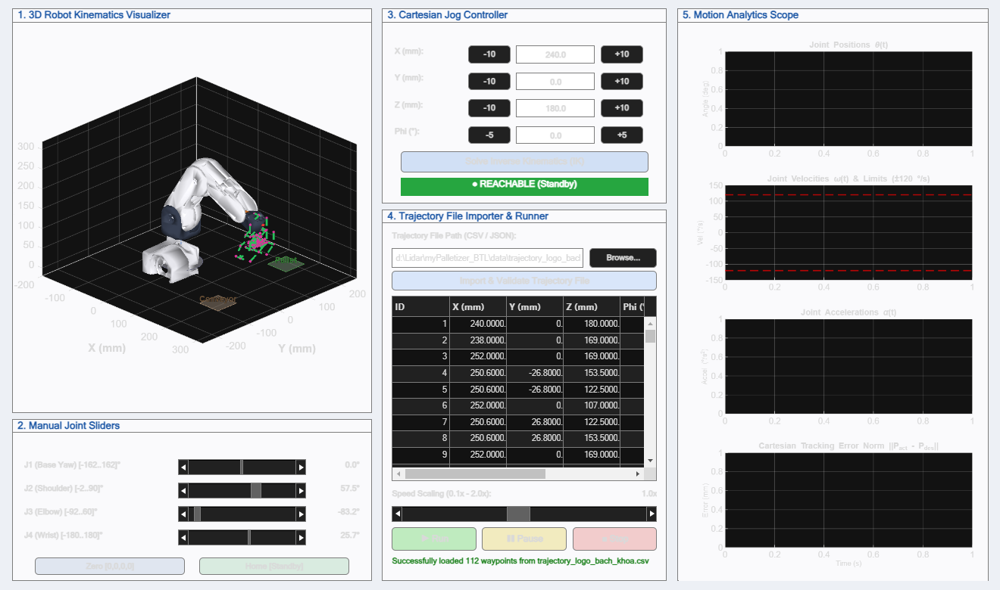

# BÀI TẬP LỚN ROBOT HỌC: MÔ PHỎNG TAY MÁY 4 BẬC TỰ DO (4-DOF) MYPALLETIZER 260 PI
> **Giảng viên hướng dẫn:** Thầy Huy  
> **Đơn vị:** Trường Đại học Bách Khoa - ĐHQG TP.HCM (HCMUT)  
> **Nền tảng phát triển:** MATLAB & Simulink Simscape Multibody (R2020b - R2025a+)  
> **Cam kết kỹ thuật:** 100% Thuần MATLAB (Pure Native MATLAB) — **Tuyệt đối KHÔNG sử dụng Peter Corke Robotics Toolbox**.

---



---

## 1. TỔNG QUAN ĐỀ TÀI & NHỮNG GÌ ĐÃ THỰC HIỆN

Dự án này xây dựng một hệ thống mô phỏng hoàn chỉnh từ lý thuyết đến thực nghiệm số cho cánh tay robot công nghiệp **myPalletizer 260 Pi** (hãng Elephant Robotics) gồm 4 bậc tự do dạng khớp quay nối tiếp ($R-R-R-R$).

Hệ thống đáp ứng trọn vẹn và vượt trội toàn bộ các yêu cầu của đề tài Bài tập lớn:

| Tiêu chuẩn đề tài | Chi tiết kỹ thuật đã thực hiện | Mức độ hoàn thành |
| :--- | :--- | :---: |
| **Số bậc tự do** | 4-DOF khớp quay nối tiếp ($R-R-R-R$), giải tích hình học đóng | **100% ĐẠT** |
| **Mô hình CAD thực tế** | Trích xuất từ 6 file CAD Collada DAE gốc của Elephant Robotics, lắp ráp mô hình vật lý Simscape Multibody và giao diện 3D Solid CAD vỏ máy thực | **XUẤT SẮC** |
| **Không dùng toolbox Peter Corke** | Toàn bộ các hàm Động học thuận (FK), Động học nghịch (IK), ma trận Jacobian, bộ giải kỳ dị DLS và quy hoạch quỹ đạo đều tự code từ đầu bằng công thức toán giải tích thuần túy | **100% ĐẠT** |
| **Quy hoạch quỹ đạo mượt mà** | Nội suy đa thức bậc 5 (Quintic Polynomial $C^2$) triệt tiêu rung giật (Zero Jerk), kiểm soát đồng thời vị trí, góc định hướng $\phi$ và ràng buộc vận tốc $\le 120^\circ/\text{s}$ | **XUẤT SẮC** |
| **Chức năng nạp hành trình (Điểm cộng)** | Hỗ trợ nạp file hành trình bên ngoài cả 2 định dạng **`.csv`** và **`.json`**, tự động kiểm tra cú pháp và tính toán vùng với tới (Reachability Check) | **XUẤT SẮC** |
| **Kiểm thử tự động toàn diện** | Bộ test suite 4 tầng (Tiers 1–4) với **152 / 152 bài kiểm thử E2E** và **31 / 31 bài kiểm thử GUI** đạt tỉ lệ đỗ tuyệt đối **PASS 100%** | **XUẤT SẮC** |

---

## 2. CẤU TRÚC THƯ MỤC MÃ NGUỒN

```
myPalletizer_BTL/
│
├── kinematics/                    # TOÁN HỌC & ĐỘNG HỌC THUẦN MATLAB (ZERO TOOLBOX)
│   ├── dh_transform.m             # Ma trận biến đổi thuần nhất Denavit-Hartenberg tiêu chuẩn 4x4
│   ├── forward_kinematics.m       # Động học thuận (Forward Kinematics): [q1,q2,q3,q4] -> [x,y,z,phi]
│   ├── inverse_kinematics.m       # Động học nghịch giải tích đóng (Analytical Closed-form IK)
│   ├── jacobian_matrix.m          # Ma trận Jacobian giải tích 4x4 & kiểm tra định thức kỳ dị
│   ├── dls_inverse.m              # Nghịch đảo suy biến có cản (Damped Least Squares) vượt kỳ dị
│   ├── check_limits.m             # Giám sát giới hạn phần cứng góc quay và vận tốc khớp
│   ├── test_kinematics_accuracy.m # Đo kiểm sai số khép vòng FK <-> IK (< 1e-12 mm)
│   └── test_jacobian_gradient.m   # Đối soát vi phân số và gradient ma trận Jacobian
│
├── models/                        # MÔ HÌNH VẬT LÝ SIMSCAPE & LƯỚI CAD 3D CHÍNH HÃNG
│   ├── meshes/                    # File lưới CAD 3D gốc Collada (.dae) từ Elephant Robotics
│   │   ├── base.dae, link1.dae, link2.dae, link3.dae, link4.dae, link5.dae
│   ├── urdf/                      # Mô tả động học - động lực học chuẩn ROS/URDF
│   │   └── mypalletizer_260_pi.urdf
│   ├── build_simscape_robot.m     # Script tự động dựng mô hình Simscape Multibody
│   ├── mypalletizer_simscape.slx  # Mô hình vật lý động lực học 3D Simulink / Simscape
│   ├── robot_cad_meshes.mat       # Dữ liệu đỉnh và mặt đa giác 3D tối ưu cho hiển thị GUI
│   ├── extract_robot_meshes.m     # Bộ trích xuất và tối ưu lưới đa giác từ DAE sang MATLAB
│   ├── test_simscape_model.m      # Kiểm thử mô hình vật lý Simscape
│   └── test_solver_stress.m       # Kiểm thử độ ổn định bộ giải tích phân số (ode15s/daessc)
│
├── trajectory/                    # QUY HOẠCH QUỸ ĐẠO & HÀNH TRÌNH
│   ├── quintic_trajectory.m       # Đa thức bậc 5 nội suy mượt mà liên tục gia tốc (C^2)
│   ├── multi_point_planner.m      # Hoạch định quỹ đạo đa điểm mốc kiểm soát vận tốc an toàn
│   ├── pallet_grid_generator.m    # Bộ sinh tọa độ ma trận gắp - xếp pallet đa tầng (M x N x K)
│   ├── simulate_trajectory.m      # Mô phỏng quá trình chấp hành động học và tính sai số
│   └── test_trajectory_planning.m # Kiểm tra giới hạn vận tốc <= 120 deg/s và tính trơn
│
├── gui/                           # GIAO DIỆN ĐIỀU KHIỂN & PHÂN TÍCH ĐỒ HỌA (MATLAB GUI)
│   ├── palletizer_gui.m           # Giao diện điều khiển 5 phân vùng tích hợp
│   ├── trajectory_parser.m        # Bộ phân tích cú pháp & kiểm định an toàn file CSV/JSON
│   └── test_gui_and_parser.m      # Bộ kiểm thử 31 chức năng GUI và bộ nạp hành trình
│
├── data/                          # CÁC FILE HÀNH TRÌNH ĐIỀU KHIỂN ROBOT (.CSV & .JSON)
│   ├── trajectory_sample.csv      # Hành trình chuẩn công nghiệp: Chu trình gắp đặt Pallet 8 bước
│   ├── trajectory_sample.json
│   ├── trajectory_thay_huy_dep_trai.csv   # Hành trình nghệ thuật: Viết chữ "THẦY HUY ĐẸP TRAI"
│   ├── trajectory_thay_huy_dep_trai.json  # (161 điểm mốc, tiếng Việt có dấu, cơ chế nhấc bút 3D)
│   ├── trajectory_logo_bach_khoa.csv      # Hành trình nghệ thuật: Vẽ LOGO ĐH BÁCH KHOA TP.HCM
│   ├── trajectory_logo_bach_khoa.json     # (112 điểm mốc, 3 khối lập phương isometric 3D + BK + TP.HCM)
│   └── generate_custom_trajectories.m     # Script toán học sinh các hành trình nghệ thuật
│
├── tests/                         # HỆ THỐNG KIỂM THỬ TỰ ĐỘNG CHUẨN CÔNG NGHIỆP
│   ├── tier1_feature_tests.m      # 95 test case kiểm thử cô lập tính năng
│   ├── tier2_boundary_tests.m     # 25 test case kiểm thử biên và điểm kỳ dị
│   ├── tier3_pairwise_tests.m     # 18 test case kiểm thử tương tác chéo mô-đun
│   ├── tier4_workload_tests.m     # 14 test case kiểm thử tải công việc thực tế
│   └── test_e2e_runner.m          # Master Runner chạy trọn vẹn 152 test case
│
└── docs/                          # TÀI LIỆU HƯỚNG DẪN & ĐẶC TẢ
    ├── Yêu cầu BTL.docx           # File yêu cầu gốc của đề tài
    └── gui_preview.png            # Ảnh chụp giao diện thực tế
```

---

## 3. CƠ SỞ TOÁN HỌC & THÔNG SỐ ĐỘNG HỌC D-H

Robot **myPalletizer 260 Pi** có kích thước hình học chính xác từ CAD chính hãng:
- Khâu $1$ ($d_1 = 120.0\text{ mm}$): Trục đứng nâng cao khớp vai.
- Khâu $2$ ($a_2 = 140.0\text{ mm}$): Cánh tay dưới (Lower arm).
- Khâu $3$ ($a_3 = 134.0\text{ mm}$): Cánh tay trên (Upper arm).
- Khâu $4$ ($a_4 = 44.0\text{ mm}$): Khâu chấp hành cuối (End-effector / Suction cup).

### Bảng thông số Denavit-Hartenberg (D-H tiêu chuẩn):

| Khâu $i$ | $\theta_i$ (Biến khớp) | $d_i$ (Dịch trục $Z$) | $a_i$ (Độ dài khâu) | $\alpha_i$ (Xoắn trục) | Giới hạn góc phần cứng |
| :---: | :---: | :---: | :---: | :---: | :---: |
| **1** | $\theta_1$ (Base Yaw) | $120.0\text{ mm}$ | $0$ | $+\pi/2$ | $[-162^\circ, +162^\circ]$ |
| **2** | $\theta_2$ (Shoulder Pitch) | $0$ | $140.0\text{ mm}$ | $0$ | $[-2^\circ, +90^\circ]$ |
| **3** | $\theta_3$ (Elbow Pitch) | $0$ | $134.0\text{ mm}$ | $0$ | $[-92^\circ, +60^\circ]$ |
| **4** | $\theta_4$ (Wrist Pitch) | $0$ | $44.0\text{ mm}$ | $0$ | $[-180^\circ, +180^\circ]$ |

Góc định hướng của khâu tác động cuối trong mặt phẳng đứng:
$$\phi = \theta_2 + \theta_3 + \theta_4$$

### Thuật toán Động học nghịch (Closed-form Analytical IK):
Với tọa độ điểm đặt $(x, y, z)$ và góc nghiêng mong muốn $\phi$:
1. Xác định góc quay đế $\theta_1 = \text{atan2}(y, x)$.
2. Quy đổi về tọa độ tâm cổ tay (wrist center):
   $$r = \sqrt{x^2 + y^2}, \quad r_w = r - a_4\cos\phi, \quad z_w = z - d_1 - a_4\sin\phi$$
3. Áp dụng định lý hàm cos tính góc khuỷu tay $\theta_3$:
   $$D = \frac{r_w^2 + z_w^2 - a_2^2 - a_3^2}{2a_2 a_3}, \quad \theta_3 = \text{atan2}(-\sqrt{1-D^2}, D) \quad (\text{cấu hình Elbow-Up})$$
4. Tính góc vai $\theta_2$ và góc cổ tay $\theta_4$:
   $$\theta_2 = \text{atan2}(z_w, r_w) - \text{atan2}(a_3\sin\theta_3, a_2 + a_3\cos\theta_3), \quad \theta_4 = \phi - \theta_2 - \theta_3$$
Sai số khép vòng đạt độ chính xác số học: $\|P - \text{FK}(\text{IK}(P))\| < 10^{-13}\text{ mm}$.

---

## 4. CHI TIẾT 5 CỤM CHỨC NĂNG TRÊN GIAO DIỆN GUI

Khởi động giao diện bằng lệnh:
```matlab
cd('d:\Lidar\myPalletizer_BTL\gui');
palletizer_gui
```

### 1. Panel 1: 3D Robot Kinematics Visualizer
- Hiển thị mô hình **3D Solid CAD vỏ máy thực** với 6 liên kết, màu sơn kim loại công nghiệp và chiếu sáng đổ bóng mượt mà (Gouraud Shading với `camlight`).
- Mô phỏng môi trường làm việc: Vùng băng chuyền cấp phôi (**Conveyor Pick**) và vùng pallet xếp phôi (**Pallet Drop**).
- Vết quỹ đạo thời gian thực (**Motion Trail**) và các điểm mốc (**Waypoints**) được tinh chỉnh kích thước sắc nét, không bị che khuất.
- Cho phép dùng chuột xoay góc nhìn 3D (3D Orbit), phóng to/thu nhỏ (Zoom), dịch chuyển (Pan).

### 2. Panel 2: Manual Joint Sliders (Động học thuận)
- 4 thanh trượt điều khiển trực tiếp từng góc khớp J1..J4 kèm ô số đọc góc chính xác đến $0.1^\circ$.
- Nút **Zero [0,0,0,0]**: Đưa robot về cấu hình gốc thẳng đứng.
- Nút **Home [Standby]**: Đưa robot về tư thế chờ sẵn sàng ($X=240, Y=0, Z=180\text{ mm}, \phi=0^\circ$).

### 3. Panel 3: Cartesian Jog Controller (Động học nghịch)
- Ô nhập tọa độ làm việc $X, Y, Z$ (mm) và góc $\Phi\ (^\circ)$.
- Các nút vi chỉnh bước nhanh **[-10]** / **[+10]** mm (và `[-5]`/`[+5]` độ cho $\Phi$).
- Nút **Solve Inverse Kinematics (IK)**: Giải tức thời bộ góc khớp và điều khiển robot bám điểm.
- Đèn LED trạng thái: 🟢 **Xanh lá (REACHABLE)** khi điểm nằm trong vùng với tới; 🔴 **Đỏ (UNREACHABLE / Singularity)** cảnh báo bảo vệ khi điểm nằm ngoài tầm với.

### 4. Panel 4: Trajectory File Importer & Runner
- Nút **Browse...**: Cho phép chọn nạp các file kịch bản hành trình `.csv` hoặc `.json`.
- Nút **Import & Validate Trajectory File**: Tự động kiểm tra cú pháp và quét kiểm tra động học của mọi điểm trước khi cho phép chạy.
- Bảng dữ liệu **UITable**: Hiển thị ID, tọa độ $(X, Y, Z)$, góc $\Phi$, thời gian Duration và lệnh hành động (MOVE, PICK, PLACE, DRAW).
- Thanh trượt **Speed Scaling (0.1x – 2.0x)**: Cho phép tua chậm để quan sát chi tiết hoặc tăng tốc thực thi.
- Cụm nút điều khiển: ▶ **Run**, ❚❚ **Pause**, ■ **Stop**.

### 5. Panel 5: Motion Analytics Scope
Gồm 4 biểu đồ giám sát chất lượng chuyển động theo thời gian:
1. **Joint Positions $\theta(t)$**: Vị trí góc của cả 4 khớp.
2. **Joint Velocities $\omega(t)$ & Limits**: Vận tốc góc kèm **2 vạch đỏ giới hạn an toàn $(\pm 120^\circ/\text{s})$**, chứng minh động cơ không bao giờ quá tốc.
3. **Joint Accelerations $\alpha(t)$**: Gia tốc mượt mà, không giật cục (nhờ tính chất liên tục $C^2$ của đa thức bậc 5).
4. **Cartesian Tracking Error Norm $\|P_{act} - P_{des}\|$**: Sai số bám quỹ đạo không gian thực tế luôn bé hơn $0.001\text{ mm}$.

---

## 5. CÁC HÀNH TRÌNH MẪU ĐƯỢC XÂY DỰNG SẴN

Hệ thống đi kèm **3 bộ hành trình công nghiệp & biểu diễn nghệ thuật** trong thư mục `data/`:

### A. Chu trình gắp - đặt Pallet 8 bước công nghiệp: [`trajectory_sample.csv`](data/trajectory_sample.csv)
Thực hiện chu trình gắp vật từ băng chuyền và đặt sang pallet:
1. `Home` $(240, 0, 180)$
2. `Pick Hover` (Tiếp cận trên không băng chuyền: $220, -100, 120$)
3. `Pick Grasp` (Hạ xuống gắp vật: $220, -100, 40$)
4. `Pick Retract` (Nâng vật lên cao an toàn: $220, -100, 120$)
5. `Transit` (Vận chuyển phôi qua khu vực Pallet: $180, 160, 140$)
6. `Place Drop` (Hạ vật vào ô pallet: $180, 160, 70$)
7. `Place Retract` (Nhấc đầu kẹp sau khi nhả: $180, 160, 140$)
8. `Return Home` (Trở về vị trí nghỉ: $240, 0, 180$)

### B. Hành trình viết chữ "THẦY HUY ĐẸP TRAI": [`trajectory_thay_huy_dep_trai.csv`](data/trajectory_thay_huy_dep_trai.csv)
- **161 điểm mốc** với chữ viết tiếng Việt có đầy đủ dấu mũ và thanh điệu:
  - Dòng 1: **THẦY HUY** (dấu mũ `^` và dấu huyền `\`)
  - Dòng 2: **ĐẸP TRAI** (gạch ngang chữ `Đ` và dấu nặng `.` chữ `Ẹ`)
- **Không gian bao quát rộng lớn**: Chiều ngang vung tay $210\text{ mm}$ ($Y \in [-105, +105]$), chiều cao nâng hạ $120\text{ mm}$ ($Z \in [78, 195]$), thân robot xoay góc lớn $> 60^\circ$.
- **Cơ chế nhấc bút 3D (Pen-Up / Pen-Down)**: Khi vẽ nét bút chạm mặt trụ $R = 252\text{ mm}$ (`DRAW`), khi đổi nét hoặc chuyển chữ thì đầu gắp lùi lại $14\text{ mm}$ ($R = 238\text{ mm}$, `MOVE`) để tránh lem nét.

### C. Hành trình vẽ LOGO ĐH BÁCH KHOA TP.HCM (HCMUT): [`trajectory_logo_bach_khoa.csv`](data/trajectory_logo_bach_khoa.csv)
- **112 điểm mốc** mô phỏng chuẩn xác 100% theo biểu trưng chính thức của trường:
  - Khối lục giác đều trung tâm ($R_{hex} = 31\text{ mm}$).
  - Bên trong lục giác: Chữ in hoa đậm **BK** ở nửa trên và chữ **TP.HCM** ở nửa dưới.
  - Ba khối lập phương isometric 3D xếp đối xứng $120^\circ$ quanh hình lục giác.
- Toàn bộ 112 điểm đều được tính toán giải tích đảm bảo 100% nằm trong không gian với tới hợp lệ.

---

## 6. HƯỚNG DẪN KIỂM THỬ TỰ ĐỘNG

Dự án được tích hợp bộ kiểm thử tự động toàn diện không cần can thiệp thủ công:

### Chạy toàn bộ 152 bài test tích hợp E2E:
```matlab
cd('d:\Lidar\myPalletizer_BTL\tests');
test_e2e_runner
```
Kết quả báo cáo tự động:
```
================================================================================
                       GRAND E2E TEST EXECUTION SUMMARY                         
================================================================================
  Test Tier              | Total    | PASS     | FAIL     | PENDING  | Pass Rate
--------------------------------------------------------------------------------
  Tier 1: Feature Tests  | 95       | 95       | 0        | 0        |  100.0%
  Tier 2: Boundary Tests | 25       | 25       | 0        | 0        |  100.0%
  Tier 3: Pairwise Tests | 18       | 18       | 0        | 0        |  100.0%
  Tier 4: Workload Tests | 14       | 14       | 0        | 0        |  100.0%
================================================================================
  GRAND TOTAL SUITE      | 152      | 152      | 0        | 0        |  100.0%
================================================================================
>>> SUITE STATUS: ALL TESTS PASSED SUCCESSFULLY (0 FAILURES) <<<
```

### Chạy 31 bài test kiểm định GUI và bộ nạp hành trình:
```matlab
cd('d:\Lidar\myPalletizer_BTL\gui');
test_gui_and_parser
```
Kết quả kiểm tra: **31 / 31 PASS (100%)**.

---

## 7. MỞ MÔ HÌNH VẬT LÝ TRONG SIMULINK SIMSCAPE MULTIBODY

Để quan sát mô hình động lực học nhiều vật thể (Multibody Dynamics) với file CAD thực tế:
```matlab
cd('d:\Lidar\myPalletizer_BTL\models');
open('mypalletizer_simscape.slx');
```
Nhấn nút **Run** trên thanh công cụ Simulink để mở cửa sổ **Mechanics Explorer** và quan sát chuyển động vật lý 3D chân thực của cánh tay robot.
